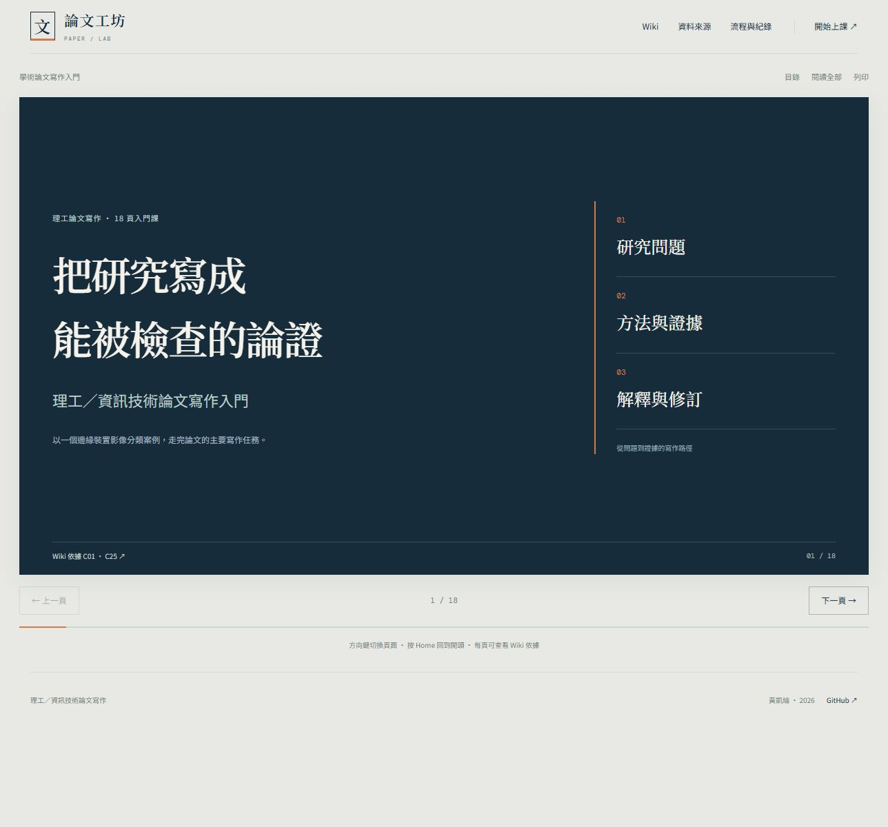

# 論文工坊：理工／資訊技術論文寫作 LLM Wiki

以 MIT EECS、Purdue OWL 與臺大中英文教學為來源，整理成可追查的知識庫，再製作給第一次撰寫理工論文者使用的教學 HTML 簡報。

- [LLM Wiki](https://iamzc0204.github.io/paper-writing-wiki/wiki/)
- [18 頁教學 HTML 簡報](https://iamzc0204.github.io/paper-writing-wiki/slides/)
- [loop / graph、執行結果與反思](https://iamzc0204.github.io/paper-writing-wiki/workflow/)
- [9 份來源與 ingest 紀錄](https://iamzc0204.github.io/paper-writing-wiki/sources/)
- [六項繳交內容 PDF](docs/submission.pdf)

## 成果

九份來源（七份英文、兩份中文）經過實際取得與原文定位，形成八個 Wiki 概念頁、25 個來源主張。十八次 Wiki 查詢支援十八頁教學，保存 37 筆投影片與主張的對應。以自行編寫的邊緣裝置影像分類案例，串起研究問題、文獻、方法、實驗、結果、討論、摘要、段落、引用與修訂。另附四項學習目標、各頁的練習完成標準及完整摘要示例。

每張投影片的「Wiki 依據」可以回到概念頁及原始教材；簡報支援目錄、方向鍵、整份閱讀、列印與兩題互動練習。

## 先討論，後生成

[生成前的討論](records/discussion.md) 保留教學對象與範圍的決定：使用者選定「理工／資訊技術論文」。LLM 在此次對話中閱讀來源、整理知識、判讀適用範圍並撰寫教學分鏡。程式負責取得、查詢、編號核對、排版與保存紀錄；重建網站不需要模型 API 金鑰。

## loop / graph

討論範圍 → 取得資料 → **來源適用範圍判讀** → 整理 Wiki → 查詢 Wiki → 編寫分鏡 → 主張核對 → 產生 HTML → 檢查頁面 → 發布。

- 來源不明確：回到原文與範圍判讀，再整理 Wiki。
- 投影片缺依據：回到 Wiki 查詢或補充知識，再改寫分鏡。
- 版面問題：修正樣式或生成器，再檢查頁面。

[完整 SVG](diagram/workflow/workflow.svg) · [PNG](diagram/workflow/workflow@2x.png)

## 一次實際執行

[v1](records/run-v1.json) 在最後內容檢查時攔下兩項待判讀內容：摘要建議篇幅是否可視為通用規定，以及一般引用教學對會議論文的看法是否適用資訊領域。處理結果保存在 [scope-review.json](content/scope-review.json)。

[v2](records/run-v2.json) 將來源範圍檢查移至 ingest 後、Wiki 索引前，完成後通過來源、主張對應與 HTML 連結檢查。這次最常卡關的是來源範圍判讀，因此先判讀、後編譯，減少把不適用的規則帶入教學。詳見 [反思](records/reflection.md) 與 [瀏覽器檢查](records/browser-check.json)。

本輪檢閱新增 [v3](records/run-v3.json)：[原版檢查實驗](records/review-baseline.json) 確認相同編號但不同文字會漏檢，因此加入版本、全文及逐頁語意核對；[六項檢查實驗](records/verification.json) 全部符合預期。[18 頁語意判讀](content/slide-review.json) 區分來源原則與教學應用，並核對整個案例的數字。

## 本機執行

需要 Node.js 22 或更新版本，沒有第三方執行相依套件。

```sh
npm run check
npm run build
npm start
```

開啟 `http://127.0.0.1:5175/`。也可以直接開啟 `site/index.html` 瀏覽靜態成果。

```sh
npm run query -- 摘要
npm run ingest
npm run run -- v3
npm run verify
```

`query` 查詢已整理的 Wiki；`ingest` 重新取得來源；`run -- v3` 重新執行已核定內容的查詢、檢查與 HTML 產出，會更新 `records/run-v3.json`。`node scripts/verify.mjs --record` 可保存六項檢查實驗的實際結果。v1、v2 保留為原始作業執行紀錄。

## 內容結構與延伸

| 位置 | 用途 |
| --- | --- |
| `AGENTS.md` | 主題、來源、檔案與新增內容的編輯規則 |
| `content/sources.json` | 原始教材、語言、網址、定位與授權 |
| `content/knowledge.json` | 25 個來源主張與 8 個概念頁的內容 |
| `wiki/` | 編譯後可獨立閱讀的 Markdown Wiki |
| `content/queries.json` | 教學查詢與主題篩選 |
| `content/slides.json` | 由 Wiki 查詢包編寫的分鏡與主張編號 |
| `prompts/` | Wiki 編譯與教學改寫的提示規則 |
| `records/` | 來源取得、查詢、前後版本、檢查與反思 |
| `web/`、`scripts/` | 共用樣式、互動與靜態網站生成器 |
| `diagram/` | 可獨立開啟的 graph 原始 SVG 與 PNG |

例如新增「演算法偽碼」教學：先依 `AGENTS.md` 取得適用的原始教學，完成範圍判讀，新增來源與 C 主張、W 概念頁及相關連結，再新增 Q 查詢與投影片。通過對應檢查後，共用生成器會產生新概念頁、目錄與來源面板，沿用既有字體、版面與互動。

網站以 GitHub Actions 編譯並發布至 GitHub Pages。程式與自行編寫的示例可在此儲存庫檢閱；教材引用及改寫依各來源授權，MIT CommKit 部分標示 CC BY-NC 4.0，詳見網站來源頁。

[公開網址檢查紀錄](records/publication.json)：13 個 HTML 頁面及其資源，共 39 個網址全部回應 HTTP 200。


